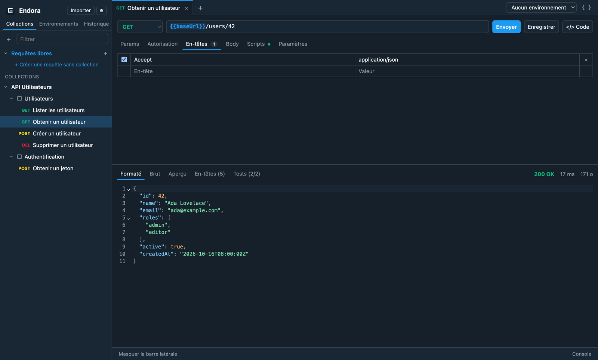

<p align="center">
  <picture>
    <source media="(prefers-color-scheme: dark)" srcset="docs/assets/wordmark-dark.png" />
    
  </picture>
</p>

<p align="center">
  <strong>Le client API de bureau, libre.</strong><br />
  Requêtes HTTP, collections, environnements, scripts et tests, Collection Runner, imports et génération de code.<br />
  Local, sans compte, open source — pour macOS, Windows et Linux.
</p>

<p align="center">
  <a href="https://github.com/lix033/endora/releases/latest"></a>
  <a href="https://github.com/lix033/endora/actions/workflows/ci.yml"></a>
  <a href="LICENSE"></a>
  <a href="https://github.com/lix033/endora/releases"></a>
</p>

<p align="center">
  <a href="#installation">Installation</a> ·
  <a href="#fonctionnalités">Fonctionnalités</a> ·
  <a href="docs/INSTALLATION.md">Guide d'installation</a> ·
  <a href="CONTRIBUTING.md">Contribuer</a> ·
  <a href="https://lix033.github.io/endora/">Site</a>
</p>

<p align="center"></p>

## Installation

| Système | Commande |
|---|---|
| **macOS** (Homebrew) | `brew install --cask lix033/tap/endora` |
| **macOS / Linux** (script) | `curl -fsSL https://lix033.github.io/endora/install.sh \| sh` |
| **Windows** (winget) | `winget install lix033.Endora` |
| **Windows** (Scoop) | `scoop bucket add lix033 https://github.com/lix033/scoop-bucket` puis `scoop install endora` |
| **Windows** (PowerShell) | `irm https://lix033.github.io/endora/install.ps1 \| iex` |

Ou téléchargez l'installeur depuis la [dernière release](https://github.com/lix033/endora/releases/latest) :

| Système | Fichier |
|---|---|
| macOS Apple Silicon / Intel | `Endora-<version>-mac-arm64.dmg` / `Endora-<version>-mac-x64.dmg` |
| Windows x64 / ARM | `Endora-Setup-<version>-x64.exe` / `Endora-Setup-<version>-arm64.exe` (ou `.zip` portable) |
| Debian, Ubuntu | `endora_<version>_amd64.deb` / `_arm64.deb` |
| Fedora, RHEL, openSUSE | `endora-<version>.x86_64.rpm` / `.aarch64.rpm` |
| Toute distribution Linux | `Endora-<version>-linux-x86_64.AppImage` / `-arm64.AppImage` |

Chaque release publie un fichier `SHA256SUMS.txt` ; les scripts d'installation vérifient les empreintes automatiquement. Le [guide d'installation](docs/INSTALLATION.md) détaille chaque méthode, la mise à jour, la désinstallation et les avertissements de sécurité de macOS et Windows.

## Fonctionnalités

- **Requêtes HTTP** — méthodes, paramètres synchronisés avec l'URL, en-têtes, bodies raw / form-data (fichiers) / x-www-form-urlencoded, HTTP/1.1 et HTTP/2, redirections, délais. Réponse formatée, brute, aperçu HTML ou image, en-têtes, temps et taille.
- **Organisation** — collections et dossiers, onglets (aperçu, rouvrir un onglet fermé), historique par jour, requêtes libres sans collection, glisser-déposer.
- **Variables** — environnements, globales, variables de collection, `{{variables}}` colorées et complétées, valeurs initiales et courantes, secrets chiffrés par le trousseau du système, variables dynamiques (`{{$guid}}`, `{{$timestamp}}`…).
- **Autorisation** — clé d'API, Bearer, Basic, Digest, OAuth 1.0, OAuth 2.0 (code, PKCE, implicite, mot de passe, identifiants client), Hawk, AWS Signature v4, NTLM, Akamai EdgeGrid, JWT, ASAP ; héritage collection → dossier → requête.
- **Scripts et tests** — scripts avant la requête et après la réponse, API `pm.*` compatible (variables, `pm.test`, `pm.expect`, `pm.sendRequest`…), exécutés dans un bac à sable isolé ; résultats des tests et console.
- **Collection Runner** — ordre réglable, itérations, délai, fichiers de données CSV/JSON, `setNextRequest`, rapport exportable.
- **Imports** — cURL (y compris collé dans l'URL), collections v1/v2/v2.1, environnements, OpenAPI 3.0/3.1, Swagger 1.2/2.0, RAML 0.8/1.0, GraphQL, HAR, WSDL 1.1/2.0, WADL ; depuis un fichier, un lien ou du texte.
- **Génération de code** — 20 langages (cURL, Python, JavaScript, Node.js, Go, Java, C#, PHP, Ruby, Rust, Swift, Kotlin, Dart, PowerShell…).
- **Application** — 5 thèmes (dont Night Owl et Solarized) avec synchronisation clair/sombre du système, raccourcis personnalisables, vérification des mises à jour.

Toutes les données restent sur votre machine (`collections/`, `environments/`, `history.json`…) ; les collections sont stockées au format collection v2.1, lisible par d'autres outils. Endora n'envoie aucune télémétrie.

## Développer

Prérequis : [Node.js 24](https://nodejs.org/) (voir `.nvmrc`) et Git.

```bash
git clone https://github.com/lix033/endora.git
cd endora
npm ci
npm run dev        # application avec rechargement à chaud
npm test           # tests (serveurs HTTP locaux réels)
npm run typecheck
npm run dist:mac   # ou dist:win / dist:linux : installeurs dans release/
```

L'architecture, les conventions et toutes les commandes sont décrites dans [docs/DEVELOPPEMENT.md](docs/DEVELOPPEMENT.md). La publication d'une version est automatisée : [docs/PUBLICATION.md](docs/PUBLICATION.md).

## Contribuer

Les contributions sont les bienvenues : signalements, idées, documentation, code. Lisez [CONTRIBUTING.md](CONTRIBUTING.md) et le [code de conduite](CODE_OF_CONDUCT.md). Pour une faille de sécurité, suivez [SECURITY.md](SECURITY.md) plutôt que d'ouvrir un ticket public.

## Licence

[MIT](LICENSE) © lix033 et les contributeurs d'Endora. Les composants tiers embarqués et leurs licences sont listés dans `THIRD_PARTY_LICENSES.txt`, livré avec chaque installeur.

Endora est un projet indépendant. Il n'est ni affilié à Postman, Inc. ni approuvé par cette société ; « Postman » est une marque de son propriétaire, citée uniquement pour décrire la compatibilité des formats de fichiers.

---

<sub>**English** — Endora is a free, open source (MIT) desktop API client for macOS, Windows and Linux: HTTP requests, collections, environments, auth, pre-request and test scripts, collection runner, imports (OpenAPI, RAML, GraphQL, HAR, WSDL, cURL) and code generation. Install with `brew install --cask lix033/tap/endora`, `winget install lix033.Endora`, or `curl -fsSL https://lix033.github.io/endora/install.sh | sh`. The interface is currently in French.</sub>
